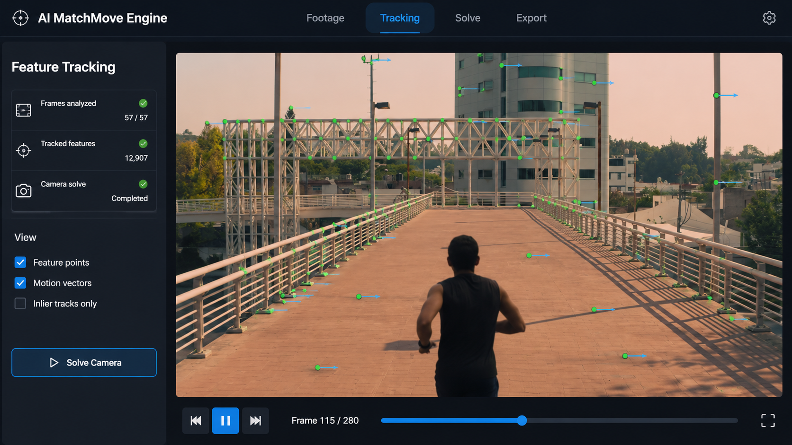
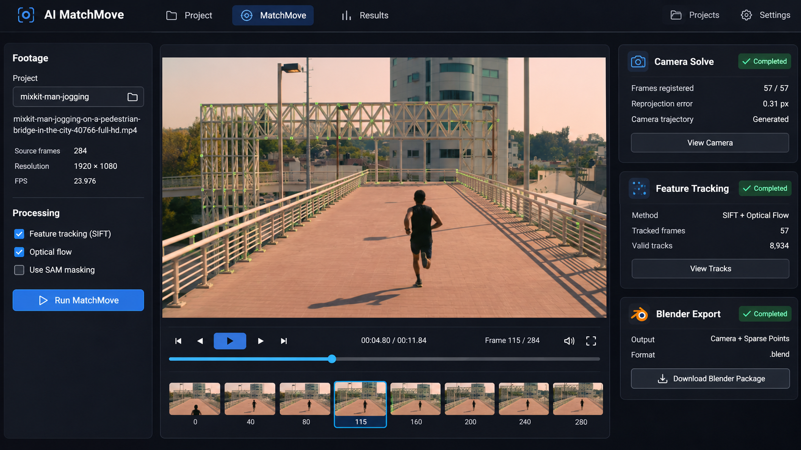
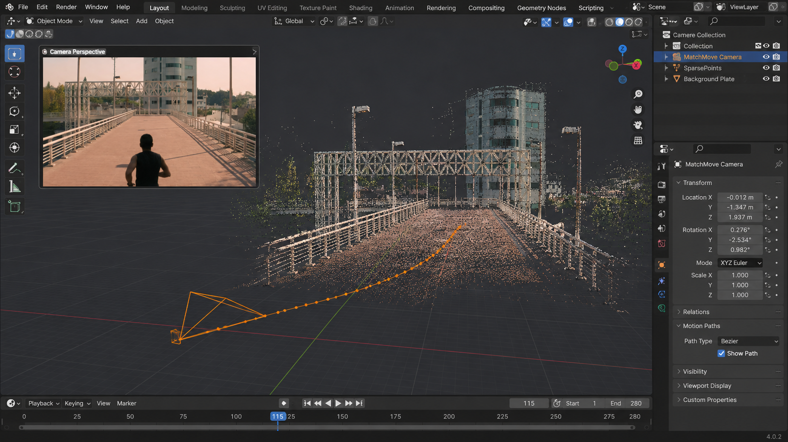

# AI MatchMove — Automated Camera Tracking for VFX

## The Problem

VFX artists need to recover a live-action camera’s motion before placing computer-generated elements in a shot. Preparing footage, tracking scene features, and reviewing a camera solve can take substantial manual work. AI MatchMove automates parts of that workflow and produces camera data that artists can inspect and use in Blender.

## What the Application Does

The FastAPI backend imports video and PNG, JPEG, or RGB EXR sequences. It prepares frames for playback in React, preserves source frame numbers, and records processing status and results for each project.

PyCOLMAP matches SIFT features, verifies correspondences, and uses sparse structure from motion and bundle adjustment to estimate camera poses, intrinsics, and 3D points. The viewer overlays reconstructed feature observations and displays the camera path and reprojection error. OpenCV optical flow helps identify moving foreground regions. Optional SAM ViT-B masks can exclude reviewed regions from the solve.

## Technology Stack

Python, FastAPI, NumPy, React, JavaScript, OpenCV optical flow, SIFT, SAM ViT-B, PyCOLMAP, FFmpeg, OpenEXR, and Blender.

## How to Run

Use Python 3.12 and FFmpeg on Linux or Ubuntu WSL, and Node.js 22.12 or newer for the frontend. Make sure `ffmpeg` and `ffprobe` are on the backend’s PATH. From the project root, start the backend:

```sh
python3 -m venv ~/.venvs/ai-matchmove
source ~/.venvs/ai-matchmove/bin/activate
python -m pip install -r backend/requirements.txt
python -m uvicorn backend.main:app --host 127.0.0.1 --port 8000
```

From the project root in a second terminal, start React and open the URL printed by Vite:

```sh
cd frontend-vite
npm ci
npm run dev
```

The baseline demo runs on CPU. For optional SAM masking, install the CPU PyTorch wheels and SAM requirements in the backend environment, then set the checkpoint path before starting FastAPI:

```sh
python -m pip install --index-url https://download.pytorch.org/whl/cpu torch==2.5.1 torchvision==0.20.1
python -m pip install -r backend/requirements-sam.txt
export MATCHMOVE_SAM_CHECKPOINT=/path/to/sam_vit_b.pth
```

Generate nine synthetic frames in a new directory from the project root:

```sh
python -m backend.demo_reconstruction --frames-only --output backend/data/demo-frames
```

Set **Sequence FPS** to `24000/1001`, upload all nine PNGs, and click **Start Camera Solve**. Inspect the result, then choose **Prepare Blender package**. Extract the ZIP and run `import_matchmove.py` in Blender’s **Scripting** workspace.

## Outputs and Limitations

Outputs include feature tracks, camera and quality JSON, a sparse point cloud, and a Blender package with camera animation and undistorted plates for registered frames. Weak parallax, low texture, or heavy occlusion can prevent a solve. Monocular scale is arbitrary. Foreground proposals need review, and masking can change reconstruction quality in either direction. [Validation results and reproduction commands](VALIDATION.md)

## AI-Generated Concept Illustrations

These visuals illustrate the intended interface and workflow. They are not actual application screenshots or verified reconstruction outputs.

### MatchMove Interface
Video processing and sequence playback.



### Feature Tracking
Feature observations and camera-motion analysis.



### Blender Reconstruction
Camera reconstruction and sparse 3D scene visualization.


