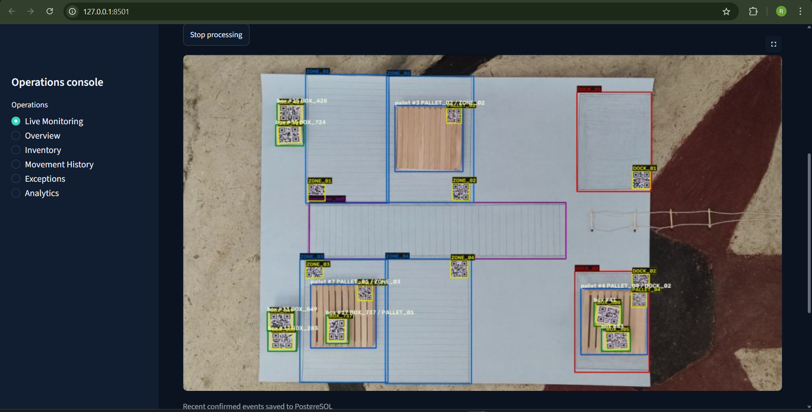
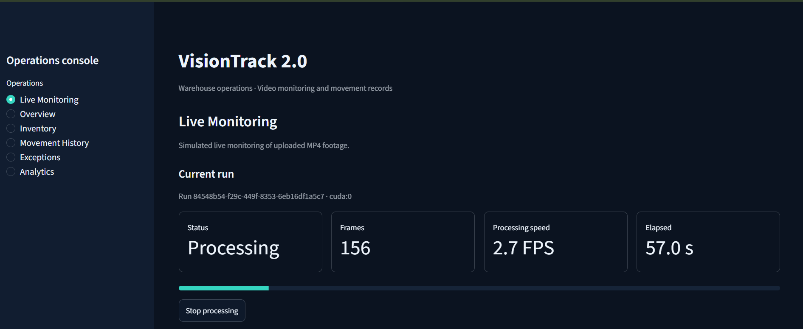
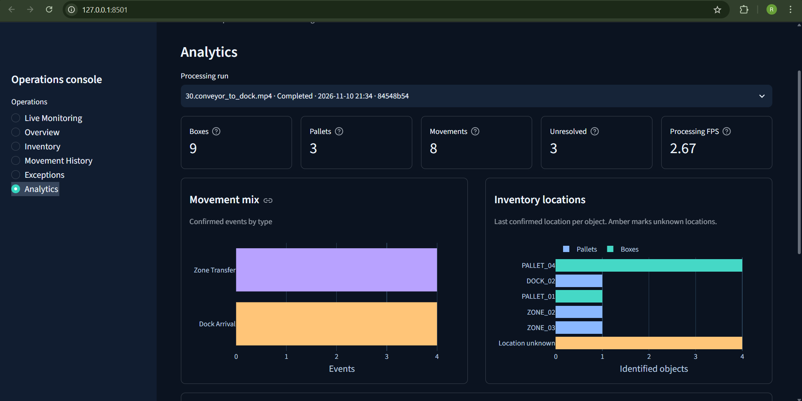
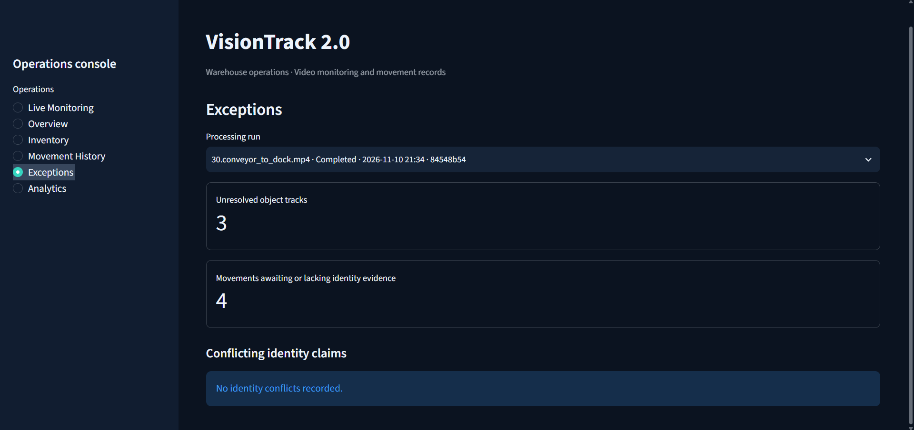
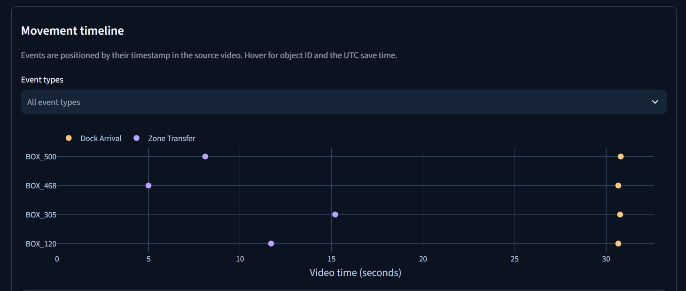

# VisionTrack 2.0 — AI-Powered Warehouse Monitoring

**VisionTrack 2.0** is a Python-based warehouse video monitoring application that combines object detection, object tracking, QR-code identification, pallet association, warehouse movement events, PostgreSQL persistence, and a Streamlit operations dashboard.

It processes **uploaded, prerecorded warehouse videos** with a live-style annotated preview. It is **not a live CCTV-streaming system**.

## Overview

The system processes warehouse footage to detect boxes, pallets, QR codes, conveyor belts, docks, and zones. It tracks objects across frames, associates boxes with pallets and detected regions, and records warehouse observations and movement events for later review.

The Streamlit interface provides video upload and processing progress, a preview of annotated frames, run history, inventory views, movement timelines, exceptions, analytics, and an annotated MP4 output.

## Key Features

- **Six-class YOLOv8 detection:** Fine-tuned model for warehouse objects and regions.
- **Object tracking:** ByteTrack-based frame-to-frame tracking.
- **QR identification:** OpenCV/Pyzbar decoding, with identity caching to avoid redundant work.
- **Box-to-pallet association:** Spatial and temporal association of objects with pallets.
- **Dynamic region awareness:** Conveyor belts, zones, and docks are detected from footage rather than assumed to be fixed camera polygons.
- **Movement-event processing:** Tracks events such as `ADD`, `MOVE`, `ZONE_TRANSFER`, and `DOCK_ARRIVAL`, with other events supported by the warehouse engine.
- **PostgreSQL persistence:** Saves processing runs, inventory-related records, movement events, and metrics.
- **Streamlit dashboard:** Monitoring, inventory, movement history, exceptions, analytics, and run selection.
- **Annotated video export:** Generates an MP4 with detections and tracking annotations.
- **Automated tests:** Tests for existing processing and warehouse logic.

## Detected Classes

The fine-tuned YOLOv8 model recognizes six classes:

1. Box
2. Pallet
3. QR code
4. Conveyor belt
5. Dock
6. Zone

## Technology Stack

| Layer | Technologies |
| --- | --- |
| Language | Python |
| Detection | YOLOv8, Ultralytics, PyTorch |
| Tracking and vision | ByteTrack, OpenCV, Pyzbar |
| Data processing | NumPy, Pandas |
| Database | PostgreSQL, Psycopg |
| Dashboard | Streamlit, Plotly |
| Video export | OpenCV, FFmpeg |
| Configuration and testing | YAML, python-dotenv, pytest |

> The repository also contains earlier MySQL-oriented components. **PostgreSQL is the storage backend for the VisionTrack 2.0 monitoring application.**

## Processing Pipeline

```text
Uploaded warehouse MP4
         |
         v
Frame decoding (OpenCV)
         |
         v
Six-class YOLOv8 detection
         |
         v
ByteTrack + detection stabilization
         |
         v
QR decoding and identity caching
         |
         v
Box/pallet association + dynamic regions
         |
         v
Warehouse event engine
         |
         +----------------------------+
         |                            |
         v                            v
PostgreSQL run/event records    Annotated frame/video output
         |                            |
         +-------------+--------------+
                       |
                       v
           Streamlit operations dashboard
```

## Application Screenshots

### Live Monitoring

Uploaded warehouse footage with object detections, tracking annotations, and detected warehouse regions.



### Processing Status

Run progress, processed-frame information, and measured processing speed.



### Analytics

Run-level inventory metrics and warehouse movement summaries.



### Exceptions

Unresolved object tracks and movements requiring additional identity evidence.



### Movement Timeline

Recorded events displayed by their positions in the source video.



## Project Structure

```text
realtime-warehouse-vision-system/
├── configs/                     # Model and runtime settings
├── data/                        # Local input data (where available)
├── database/
│   ├── migrations/              # Database migrations, including PostgreSQL monitoring
│   ├── schema/                  # Database schema files
│   └── seeds/                   # Local/demo seed data
├── docs/
│   └── screenshots/             # Screenshots used in this README
├── models/                      # Model location; weight files excluded from Git
├── outputs/                     # Generated videos and logs; excluded from Git
├── scripts/                     # Utility and launch scripts
├── src/visiontrack/
│   ├── association/             # Box, pallet, and region association
│   ├── config/                  # Configuration loading
│   ├── dashboard/               # Streamlit monitoring and analytics
│   ├── database/                # Persistence and database access
│   ├── geometry/                # Spatial utilities
│   ├── lifecycle/               # Lifecycle processing
│   ├── perception/              # Detection, QR decoding, stabilization
│   ├── pipeline/                # Video processing and monitor worker
│   ├── warehouse/               # State and movement-event rules
│   ├── cli.py                   # Command-line interface
│   └── main.py                  # Application entry point
├── tests/                       # Automated tests
├── .env.example                 # Example configuration (no real secrets)
├── requirements.txt
└── pyproject.toml
```

## Requirements

- Python **3.10+** (the project was developed using Python 3.11)
- PostgreSQL, configured locally or on an accessible server
- FFmpeg available on `PATH` for annotated MP4 encoding
- The project's fine-tuned YOLOv8 checkpoint (`models/six_class_final.pt`)
- An NVIDIA CUDA-capable GPU is recommended for faster inference, but actual speed depends on the hardware and processing workload

## Installation (Windows CMD)

Run these commands from the project root:

```cmd
py -3.11 -m venv .venv
.venv\Scripts\python.exe -m pip install --upgrade pip
.venv\Scripts\python.exe -m pip install -r requirements.txt
.venv\Scripts\python.exe -m pip install -e .
```

**CUDA note:** If the PyTorch requirement does not match your GPU/driver environment, install a compatible PyTorch build before running GPU inference. Do not assume every system has the same CUDA configuration.

### Environment configuration

Create a private `.env` file:

```cmd
copy .env.example .env
```

Set the PostgreSQL connection variables in `.env`:

```dotenv
VISIONTRACK_PG_HOST=localhost
VISIONTRACK_PG_PORT=5432
VISIONTRACK_PG_DATABASE=visiontrack
VISIONTRACK_PG_USER=your_database_user
VISIONTRACK_PG_PASSWORD=your_database_password
```

Create the PostgreSQL database and apply the applicable SQL migrations in `database/migrations/` before starting a fresh installation. The VisionTrack 2.0 monitoring migration is named `003_postgresql_monitoring.sql`. Check migration dependencies and run them in the required order.

**Never commit `.env`, real credentials, or private database exports.**

### Model setup

Place the fine-tuned model file at:

```text
models/six_class_final.pt
```

Model weights are not included in this repository. Inference requires an authorized copy of the compatible checkpoint.

## Run VisionTrack 2.0

From **Windows CMD** in the project root:

```cmd
set "PYTHONPATH=%CD%\src"
.venv\Scripts\python.exe -m visiontrack monitor
```

Open the local Streamlit URL printed in the terminal. In **Live Monitoring**, upload a warehouse MP4 and start a processing run.

The dashboard displays run progress and annotated preview frames. After completion, review the database-backed inventory and event views and open or download the annotated MP4.

> **Note:** The application processes prerecorded videos; the preview simulates live monitoring. Restarting the Streamlit server can terminate an active run.

### Video output

Completed monitoring runs write annotated video under a run-specific directory, such as:

```text
outputs/monitor/<run-id>/annotated.mp4
```

Generated videos are local artifacts and are not committed to GitHub.

## Dashboard Sections

- **Live Monitoring:** Video upload, run progress, annotated preview, and output video.
- **Inventory:** Recorded box/pallet observations and associated locations.
- **Movement History:** Events logged for a selected run.
- **Exceptions:** Unresolved tracks and identity-evidence issues.
- **Analytics:** Run-level metrics, event counts, and movement timelines.

Displayed values depend on the selected run and available PostgreSQL records. A database event is **not** independent proof that the physical movement was interpreted correctly.

## Tests

Run:

```cmd
.venv\Scripts\python.exe -m pytest -q
```

**Last reported Codex test run:** `44 passed, 1 failed`. Codex reported that the remaining legacy test expects one event where the existing engine emits both registration and `ADD`. This issue should not be described as a fully passing test suite until it is resolved and rerun.

## Performance Notes

The app reports processing throughput for each run. End-to-end FPS depends on video resolution, model inference, QR decoding, tracking, database writes, video encoding, and the available GPU/CPU.

A **previous pipeline** had a separately reported Tesla T4 benchmark of **3.9 → 7.1 FPS** after QR-processing optimizations. That number **is not a measured Tesla T4 result for VisionTrack 2.0** and should not be used as one.

## Known Limitations

- Some labels may overlap in crowded annotated frames.
- Unresolved identities and observed movements require review; event correctness has not been independently validated against every source-video frame.
- The last reported automated test run included one failing legacy test.
- This is a portfolio/development application, not a production-certified warehouse inventory system.

## Repository and Data Safety

Keep the following out of the public repository:

```text
.env
.venv/
__pycache__/
.pytest_cache/
models/*.pt
models/*.pth
models/*.onnx
models/*.engine
data/input_videos/
outputs/
*.pem
*.key
```

Do not publish proprietary internship footage, model weights, customer records, or credentials without permission.

## Project Goal

VisionTrack 2.0 demonstrates an **end-to-end warehouse computer-vision workflow**: six-class object detection, tracking, QR identification, spatial association, movement-event processing, PostgreSQL persistence, annotated video export, and a searchable Streamlit dashboard.
