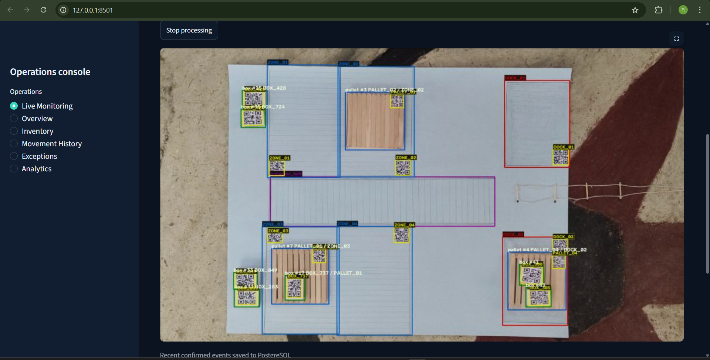
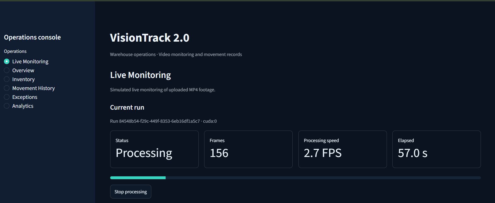
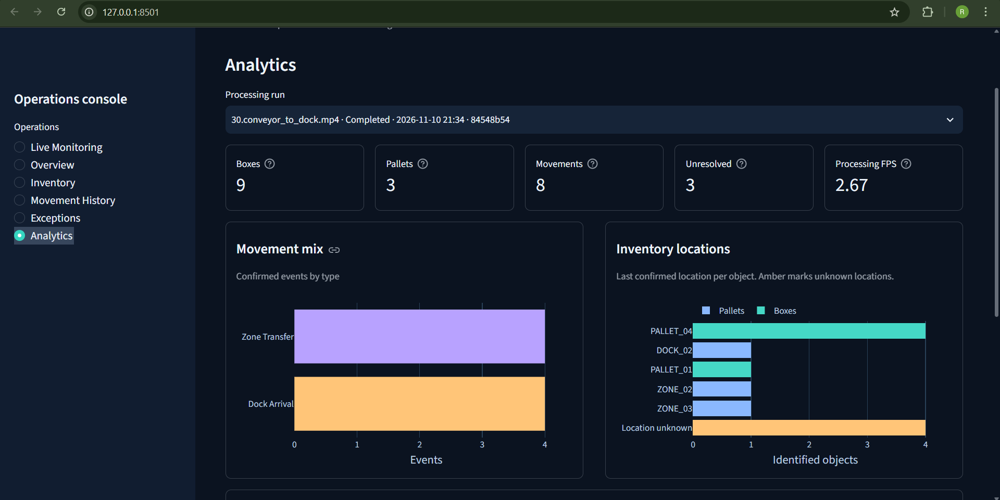
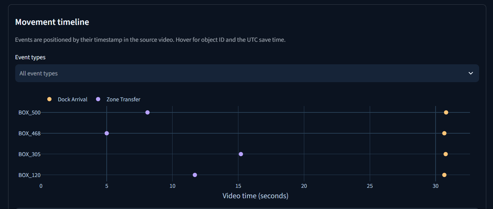
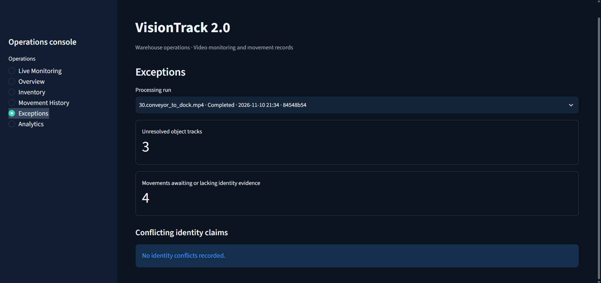

# VisionTrack — AI-Powered Warehouse Monitoring

VisionTrack turns prerecorded warehouse video into a record of which boxes were seen, where they were observed, and how they moved. It combines object detection, tracking, QR identification, and warehouse movement logic in one application.

Upload an MP4, follow the annotated preview as it processes, and review the results in a Streamlit dashboard. The application works with **prerecorded footage**, not a live CCTV feed.

## What it does

- **Detects and tracks:** A fine-tuned six-class YOLOv8 model detects boxes, pallets, QR codes, conveyors, docks, and zones. ByteTrack follows detections across frames.
- **Identifies and locates:** QR decoding identifies boxes. Spatial and temporal logic associates boxes with pallets and detected warehouse regions.
- **Records movements:** The event engine records observations such as zone transfers and dock arrivals. Unresolved identities remain available for review.
- **Makes footage reviewable:** PostgreSQL stores run records and events; Streamlit shows inventory, movement history, exceptions, and analytics. An annotated MP4 can be downloaded after processing.

## Implementation details

- **QR decoding:** The decoder works on detected QR regions rather than repeatedly decoding the full frame. It tries padded and enlarged crops, grayscale/CLAHE, sharpening, and thresholded variants; optional pyzbar decoding is also supported.
- **Track identity caching:** A decoded QR identity can be reused while its tracked QR observation remains continuous. The cache expires old records and can recheck stale or discontinuous observations.
- **Association and movement logic:** QR identities are matched to box, pallet, dock, and zone observations. The movement engine confirms transfers and records movement events rather than treating every frame-level observation as a new movement.
- **Persistence and review:** PostgreSQL stores processing runs, inventory state, events, and exceptions. The Streamlit dashboard provides video preview, movement history, analytics, and unresolved-track review.

Relevant implementation and test files:
- [QR crop decoder](src/visiontrack/perception/qr_decoder.py)
- [Perception and track-identity pipeline](src/visiontrack/perception/pipeline.py)
- [QR cache and identity tests](tests/test_qr_box_synthesis.py)
- [PostgreSQL, movement, and dashboard tests](tests/test_postgresql_monitor.py)

## Technology

**Python · YOLOv8 · PyTorch · OpenCV · ByteTrack · Pyzbar · PostgreSQL · Streamlit · Plotly · FFmpeg**

The pipeline decodes footage, detects and tracks objects, resolves available QR identities, associates boxes with pallets and locations, then writes movement records and annotated video output.

## Application screenshots

### Live monitoring

### Processing progress

### Analytics

### Movement timeline

### Exceptions

## Run locally

Requires **Python 3.11**, **PostgreSQL**, **FFmpeg**, and the compatible YOLOv8 checkpoint (not included in the repository).

From the project directory in Windows CMD:

~~~cmd
py -3.11 -m venv .venv
.venv\Scripts\python.exe -m pip install -r requirements.txt
.venv\Scripts\python.exe -m pip install -e .
copy .env.example .env
~~~

Set the VISIONTRACK_PG_* connection values in .env, create the visiontrack PostgreSQL database, and apply database/migrations/003_postgresql_monitoring.sql. Place the authorized checkpoint at models/six_class_final.pt.

~~~cmd
set "PYTHONPATH=%CD%\src"
.venv\Scripts\python.exe -m visiontrack monitor
~~~

Open the Streamlit URL shown in the terminal and upload an MP4.

## Model and benchmark availability

The active six-class checkpoint is external and is not included in this repository. The repository documents the inference and warehouse-processing pipeline; it does not currently contain the training dataset or a reproducible YOLO fine-tuning run.

The QR crop-decoding and track-identity-cache implementations are in the source files linked above. A reproducible NVIDIA Tesla T4 before/after FPS benchmark is not currently included here. The exact 4K throughput figures should be published with the test video details, model/configuration, device, warm-up procedure, measured frame counts, and raw timing results.

## Notes

Movement records reflect observations from video and may need review when tracking or QR identity is uncertain. Some labels can overlap in crowded scenes. The last reported test run also had one unresolved legacy event-engine test.
