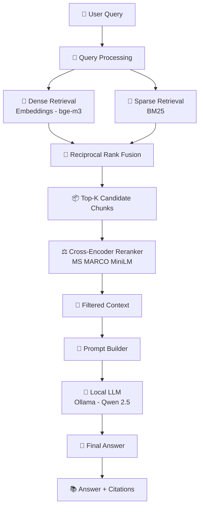

# Enterprise RAG Engine

An end-to-end Retrieval-Augmented Generation (RAG) system designed to query enterprise policy documents with high accuracy using hybrid retrieval and a locally hosted language model.

---

## Overview

This project implements a complete RAG pipeline for enterprise document understanding. It enables users to ask natural language questions and receive grounded, policy-based answers with source citations.

The system combines dense retrieval, sparse retrieval, and cross-encoder reranking to improve answer relevance, while using a locally hosted LLM (via Ollama) to ensure privacy and independence from external APIs.

---

## Key Features

* Hybrid Retrieval (Dense + BM25) for improved recall
* Reciprocal Rank Fusion (RRF) to combine retrieval signals
* Cross-Encoder Reranker for context precision
* Locally hosted LLM (Ollama - Qwen 2.5)
* FastAPI backend for scalable query handling
* Streamlit interface for interactive querying
* Source-grounded answers with document citations

---

## System Architecture



---

## Project Structure

```
src/
  ingestion/        # PDF loading, chunking, embedding, indexing
  retrieval/        # Dense, sparse retrieval + fusion + reranking
  generation/       # Prompt construction and LLM response
  api/              # FastAPI service

data/
  raw/              # Source documents
  eval/             # Evaluation dataset

config.yaml         # System configuration
app.py              # Streamlit UI
requirements.txt    # Dependencies
```

---

## Setup Instructions

### 1. Install dependencies

```
pip install -r requirements.txt
```

---

### 2. Run ingestion pipeline

```
python src/ingestion/run_ingestion.py
```

This step:

* Loads PDFs
* Splits into structured chunks
* Generates embeddings
* Indexes data in Qdrant

---

### 3. Start backend API

```
uvicorn src.api.main:app --reload
```

---

### 4. Launch UI

```
streamlit run app.py
```

---

## Example Queries

* What are the requirements for travel authorisation?
* Who needs to approve international travel for interns?
* What are the consequences of dishonest expense claims?
* Under what conditions is retrospective travel approval allowed?

---

## Design Decisions

* Hybrid Retrieval was used to balance semantic understanding (dense) and keyword matching (sparse).
* Reranking improves precision by filtering noisy or partially relevant chunks.
* Local LLM (Ollama) ensures data privacy and eliminates dependency on external APIs.
* Chunking strategy is adapted for structured enterprise documents, including section-aware splitting and table row extraction.

---

## Evaluation Insights

* Strong recall across diverse policy questions
* High grounding accuracy (minimal hallucination)
* Trade-off observed between recall and precision
* Reranking significantly improves answer relevance

---

## Tech Stack

* Python
* FastAPI
* Streamlit
* Qdrant (Vector Database)
* Sentence Transformers (bge-m3)
* Cross-Encoder (MS MARCO MiniLM)
* Ollama (Qwen 2.5 LLM)

---

## Future Improvements

* Improve context precision with adaptive filtering
* Add query rewriting for complex queries
* Optimize latency for local LLM inference
* Optional cloud deployment with lightweight models

---

## Author

Raviteja K
GitHub: https://github.com/raviteja-k-01
