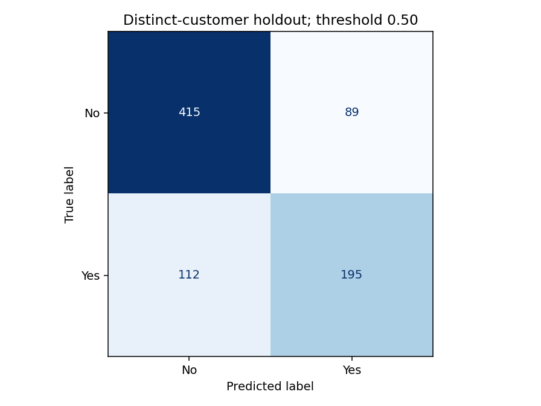
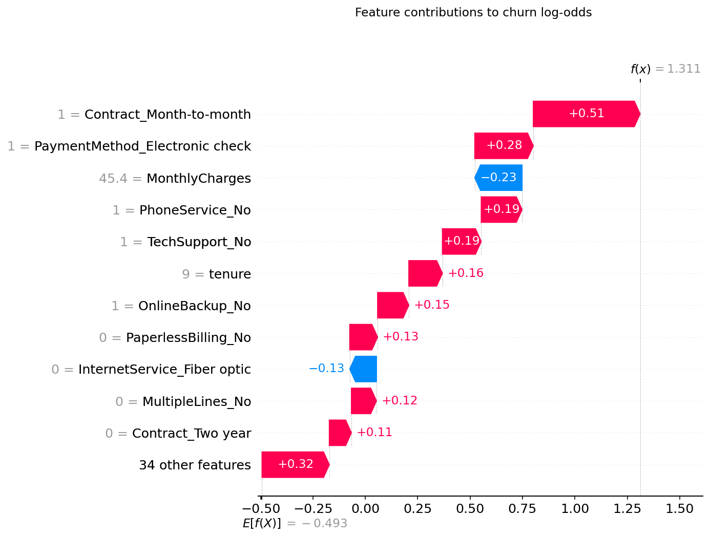

# Customer Churn Prediction

An XGBoost classifier with a Streamlit application for single-customer and CSV batch predictions. Training, inference, and SHAP explanations use the same saved preprocessing pipeline. The positive class is **Churn = Yes**.

## Dataset

The project uses the existing `data/telecom.csv`, based on the [IBM Telco Customer Churn sample](https://github.com/IBM/telco-customer-churn-on-icp4d). The supplied file is a modified, duplicate-heavy copy; its prior sampling history is not documented. It is not an untouched copy of the standard dataset.

| Property | Verified value |
| --- | ---: |
| Raw rows | 7,042 |
| Columns | 21: 19 predictors, customerID, Churn |
| Raw target counts | 3,521 No / 3,521 Yes |
| Missing or blank feature cells | 0 |
| Exact duplicate rows | 2,989 |
| Distinct customers used for modeling | 4,053 |
| Distinct-customer target counts | 2,518 No / 1,535 Yes |

The original CSV is preserved byte-for-byte. Training removes exact repeated records in memory, rejects conflicting records for the same customer ID, and splits distinct customers. Dataset counts and the SHA-256 fingerprint are recorded in [dataset_profile.json](reports/dataset_profile.json).

## Training and evaluation

1. Validate raw columns, values, customer IDs, and `Churn` labels (`No=0`, `Yes=1`). Remove exact duplicates before splitting.
2. Make a stratified 80/20 split with `random_state=42`: **3,242 training customers / 811 test customers**. No customer appears in both sets.
3. Fit numeric median imputation, categorical most-frequent imputation, and one-hot encoding on training rows only, using a scikit-learn `Pipeline` and `ColumnTransformer`. Missing cells are supported even though this supplied CSV has none. Scaling is unnecessary for the tree model and is omitted.
4. Train XGBoost with 250 trees, learning rate 0.05, maximum depth 6, subsample 0.8, column subsample 0.8, histogram trees, seed 42, and two CPU threads. No hyperparameter search or threshold tuning was performed.
5. Evaluate the held-out customers at the fixed threshold **0.50**. This holdout is not used to fit preprocessing or select this model's parameters. The same threshold is saved with the model and used by the app.
6. Save the full pipeline, reload it, and verify exact equality of all test probabilities before publishing the artifact and reports. The saved model is the evaluated training-partition model; it is not refitted on test customers.

The pipeline follows scikit-learn's [guidance on preventing preprocessing leakage](https://scikit-learn.org/stable/common_pitfalls.html#data-leakage).

### Verified held-out results

| Metric | Value |
| --- | ---: |
| ROC-AUC | **0.8465** |
| Precision, Churn=Yes | **0.6866** |
| Recall, Churn=Yes | **0.6352** |
| F1, Churn=Yes | **0.6599** |
| Accuracy | **0.7522** |

Confusion matrix, rows = actual and columns = predicted, both ordered `[No, Yes]`:

```text
                 Predicted No   Predicted Yes
Actual No                 415              89
Actual Yes                112             195
```

The test set contains 504 No and 307 Yes customers. ROC-AUC uses churn probabilities; the other metrics use the saved 0.50 threshold. Full-precision metrics, environment versions, source hashes, and model identity are in [metrics.json](reports/metrics.json). [split.csv](reports/split.csv) records every customer's partition and zero-based source row; [test_predictions.csv](reports/test_predictions.csv) supports independent metric recalculation.



Earlier results used a split containing repeated customers across training and test data and preprocessing fitted before splitting. They are not comparable evidence of performance on unseen customers. The original report also mixed No-class precision with Yes-class recall. Those claims have been replaced; the original files remain available on `backup/customer-churn-original-20261115`.

## Installation and execution

Validated on **Python 3.11.9 / Windows**, using the exact environment in `requirements-lock.txt`. Run these commands from `Machine-Learning/Customer-Churn-Prediction`:

```powershell
py -3.11 -m venv .venv
.\.venv\Scripts\Activate.ps1
python -m pip install -r requirements-lock.txt
python -m pip check
python -m src.data_inspect
python -m src.train
python -m streamlit run app/streamlit_app.py
```

On Linux/macOS, create the environment with `python3.11 -m venv .venv` and activate with `source .venv/bin/activate`. That platform setup has not been executed here. `requirements.txt` lists pinned application dependencies; `requirements-dev.txt` adds testing tools. The lock file records all versions from the validated environment.

The only training entry point is `python -m src.train`. To compare a fresh run without replacing the committed artifacts:

```powershell
python -m src.train --output-dir test-results/reproduction
```

Only load trusted model artifacts: joblib files can execute code during deserialization. The application loads the project's own `model/churn_pipeline.joblib`; it does not accept model uploads.

## Application

**Single prediction:** enter normal categories and unscaled charges/tenure, submit the form, then view the predicted class and churn probability. An unknown TotalCharges value can be imputed. Choose matching no-service options when phone or internet service is absent. Invalid inputs show field-specific errors.

**Batch prediction:** download the sample CSV in the app or upload raw customer records with all 19 feature columns below. `customerID`, `Churn`, and other extra columns are ignored by the model and retained in the output. Column order does not matter.

```text
gender, SeniorCitizen, Partner, Dependents, tenure, PhoneService,
MultipleLines, InternetService, OnlineSecurity, OnlineBackup,
DeviceProtection, TechSupport, StreamingTV, StreamingMovies,
Contract, PaperlessBilling, PaymentMethod, MonthlyCharges, TotalCharges
```

Use the category spelling in the sample/form. Surrounding whitespace is stripped. Blank cells use the fitted imputers; an absent required column is an error. Unknown categories, malformed numbers, infinity, negative charges, fractional tenure, invalid senior flags, and inconsistent service combinations are rejected. Malformed CSV rows and duplicate headers are rejected too.

For mixed batches, valid rows receive `Predicted_Churn` and `Churn_Probability`; invalid rows remain in place with blank predictions and a `Validation_Error`. The downloaded CSV contains every submitted row and its results. The probability is the model's score for **Yes**, not a confidence or calibration guarantee.

## SHAP explainability

The single-customer app displays a SHAP waterfall plot. The explainer receives the exact numeric and one-hot encoded array used by the saved XGBoost classifier. Feature names come from the fitted preprocessor. Each explanation is checked to reconstruct the model's raw score.

Contributions are in **log-odds**, as described by [SHAP's TreeExplainer documentation](https://shap.readthedocs.io/en/stable/generated/shap.TreeExplainer.html). Positive contributions increase the model's churn score. They describe the model's associations, not causal effects.

Generate standalone reports with:

```powershell
python -m src.explain
```

This explains the first 200 deduplicated rows without retraining, saving a global bar plot, a local waterfall plot, and `reports/shap_summary.json`. This descriptive sample is not an additional performance evaluation.



## Tests

```powershell
python -m pytest -q
python -m playwright install chromium
python tests/browser_smoke.py
```

The automated suite covers dataset auditing, customer separation, train-only preprocessing, missing and invalid inputs, target encoding, independently checked metrics, full-data retraining, exact serialization equality, single/batch consistency, SHAP additivity, and Streamlit interactions. The browser smoke test uses an actual Chromium session to submit a prediction, render SHAP, upload a mixed-validity CSV, download and verify results, and check file-validation errors. It starts and stops its own local server.

See [browser test results](reports/browser_smoke.json) and [model evaluation metrics](reports/metrics.json) for validation evidence.

## Project structure

```text
app/streamlit_app.py       Canonical Streamlit application
src/preprocess.py         Shared schema, validation, pipeline, inference, loading
src/train.py              Canonical training and evaluation entry point
src/explain.py            SHAP explanations and report generation
src/data_inspect.py       Read-only dataset audit
data/telecom.csv          Preserved input dataset
model/churn_pipeline.joblib  Fitted pipeline, threshold, model identity, metadata
reports/                  Metrics, split, predictions, plots, browser evidence
tests/                    Pipeline, application, and browser checks
requirements*.txt         Application, development, and exact environment pins
```

## Limitations

- The supplied dataset's earlier resampling history is unknown. Deduplication prevents repeated-customer leakage but cannot restore customers omitted before this project received the file. Results apply to this 4,053-customer cohort.
- One fixed holdout does not demonstrate stability across time, other telecom providers, or live deployments. No production deployment or business impact has been measured.
- At threshold 0.50, the model misses 112 of 307 churn cases and flags 89 of 504 non-churn cases. Operational threshold selection would require business costs and a separate validation procedure.
- Probabilities are uncalibrated, and the cohort's churn prevalence differs from a natural production population. Do not interpret scores as guaranteed real-world risk estimates.
- No temporal validation, fairness audit, or causal analysis has been performed. Gender and senior status are included among the supplied predictors.

Technologies: Python, pandas, NumPy, scikit-learn, XGBoost, Streamlit, SHAP, Matplotlib, joblib, pytest, and Playwright for browser validation.
